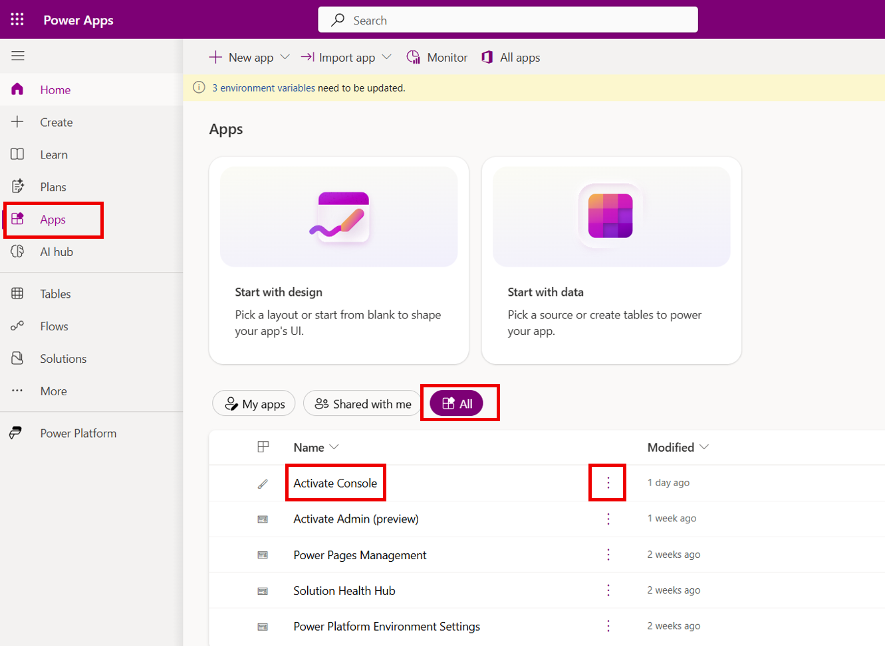

# Lab 701: Discover an SAP ECC estate with Dynamics 365 Activate

In this lab, you use Dynamics 365 Activate to create a discovery project for a
customer, run the SAP ECC Activate Discovery playbook, and review the results.
The customer wants to understand its SAP ECC estate before it commits to a
migration scope, so the results show the size and complexity of the estate and
the parts that Dynamics 365 covers out of the box.

## The customer story

Fabrikam runs its operations on SAP ECC and faces the end of mainstream
support. Before committing to a migration, the steering committee wants a
fact-based view of the estate:

*  How many tables, custom objects, integrations, and workflows the business
depends on.
*  Which processes Dynamics 365 Finance & Operations can cover without custom
development.
*  What should migrate first.

You are the migration consultant. Using Dynamics 365 Activate, you will:

*  Set up a project for Fabrikam.
*  Run the SAP ECC Discovery playbook.
*  Review the results and prepare a scope and readiness summary for steering
committee review.

The customer runs its operations on SAP ECC. The IT team needs a fact-based
view of the estate: how many tables, custom objects, integrations, and
workflows the business depends on, and which processes Dynamics 365 can cover
without custom development. You are the migration consultant. Set up a project
for the customer and produce the discovery results that the steering committee
reviews.

**Note:** The SAP ECC data and assessment results used in this lab are provided for demonstration purposes only. They represent a sample SAP ECC environment and do not contain data from an actual customer environment.

## Before you begin

*  Once you log in to your lab profile, navigate to make.powerapps.com
(https://make.powerapps.com/). On the left navigation pane, select Apps.
*  Above the list of apps, ensure that no filters have been applied. Next to
Activate Console app, select More commands (⋮), and then select Play to launch
the app.
*  Sign in to the Activate Console in Power Apps with the lab user account that
your proctor provided.
*  Dynamics 365 Activate is now launched. You can create a project or view
projects that you already have access to.
*  Use the customer and project names from Exercise 1, Task 1, Step 6 so that
your results match the screenshots.

*Figure 1. Navigate to Power Apps maker studio to launch Dynamics 365 Activate.*

## Exercises

| #   | Exercise                     | What you do                                                                                                                                                             |
| --- | ---------------------------- | ----------------------------------------------------------------------------------------------------------------------------------------------------------------------- |
| 1   | Create the project           | Choose the **Prospect** journey and **SAP ECC**, review the setup, create the project with the names from Step 6, and bind the **SAP ECC Activate Discovery** playbook. |
| 2   | Release the discovery wave   | Release the **SAP ECC Discovery** wave and track the seven tasks until they close.                                                                                      |
| 3   | Review the discovery results | Open the **Discovery overview** and review the data dictionary, packages, custom code, localization, integrations, and workflows.                                       |

## Conventions

*  Note: Additional context for a step.
*  Important: Information that you must follow to get the expected results.
*  Checkpoint: The result that you should see before you continue.

## Exercise files

1. [Exercise 1: Create the project](./exercise-1-create-the-project.md)
2. [Exercise 2: Release the discovery wave](./exercise-2-release-the-discovery-wave.md)
3. [Exercise 3: Review the discovery results](./exercise-3-review-the-discovery-results.md)
