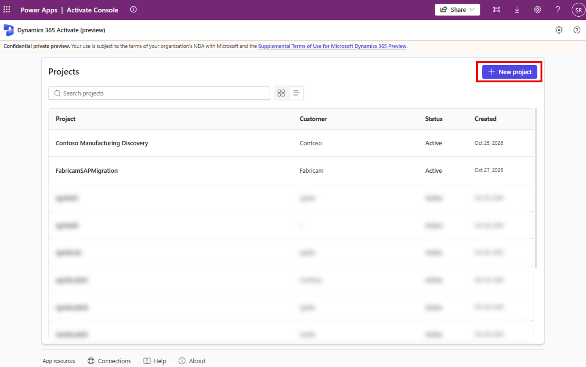
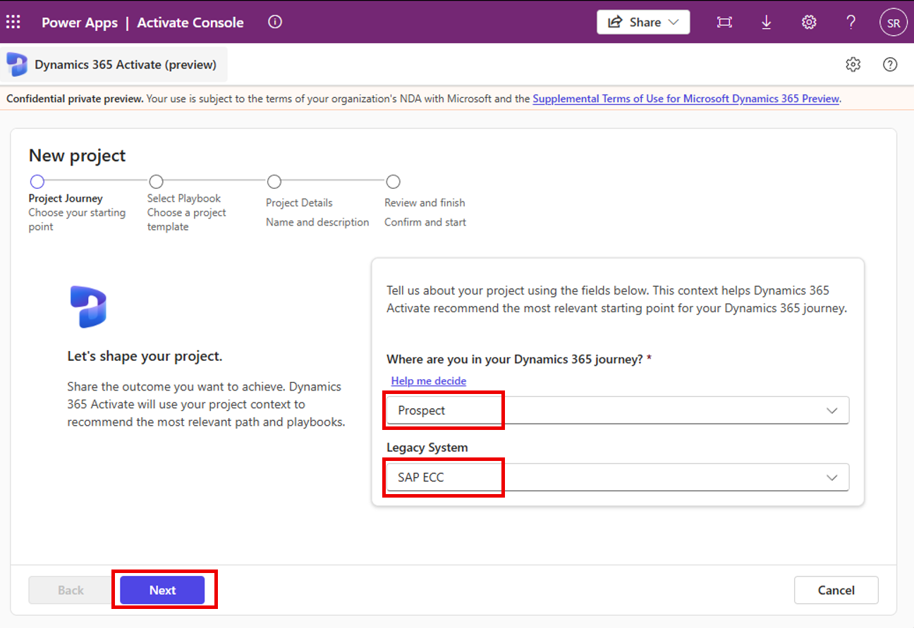
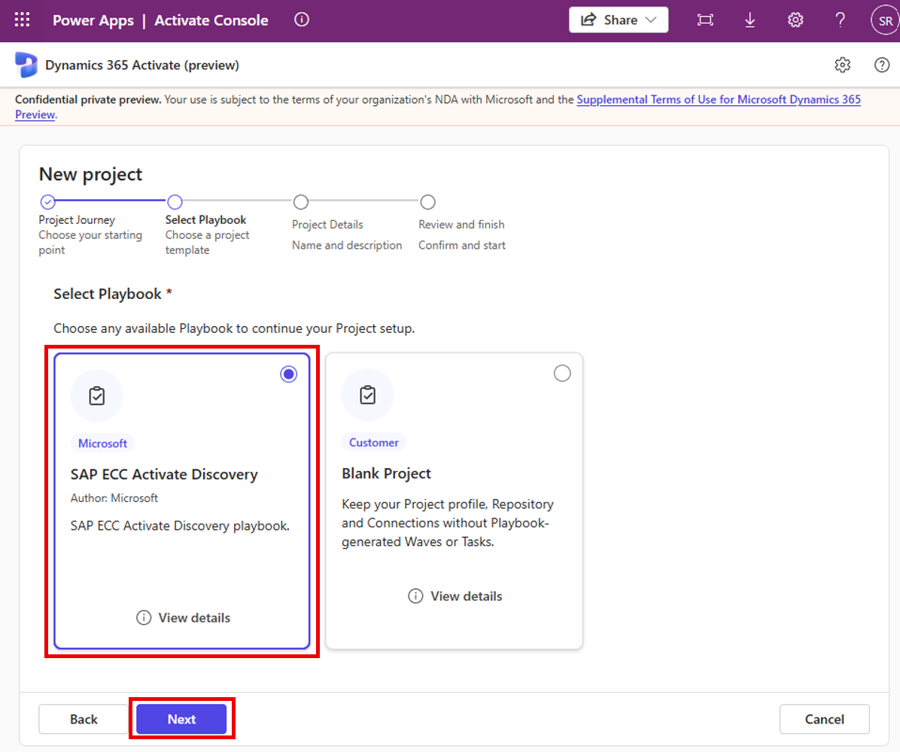
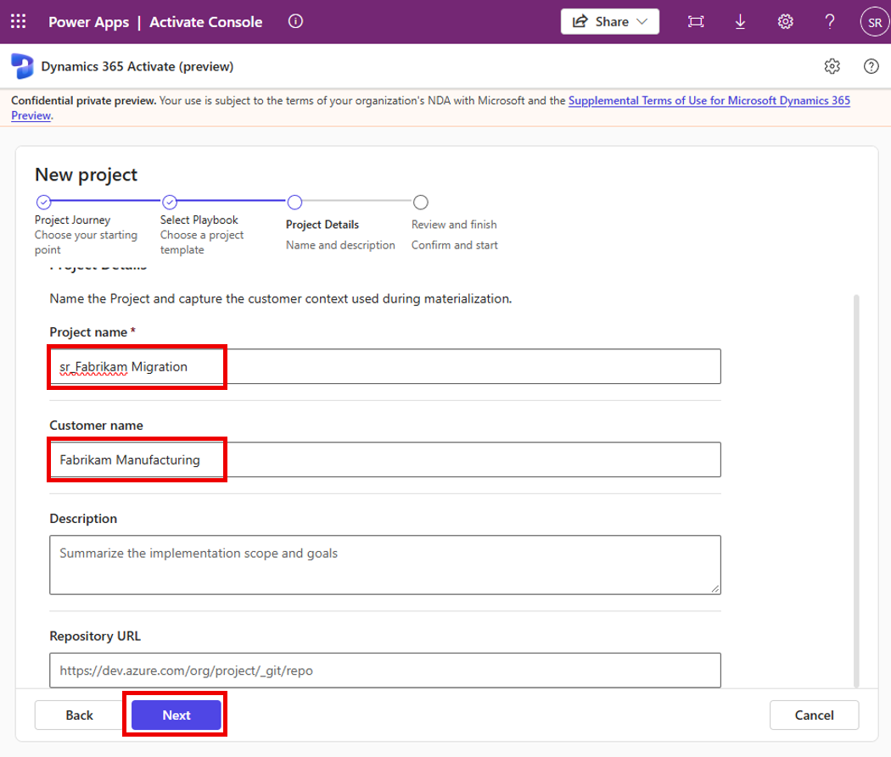
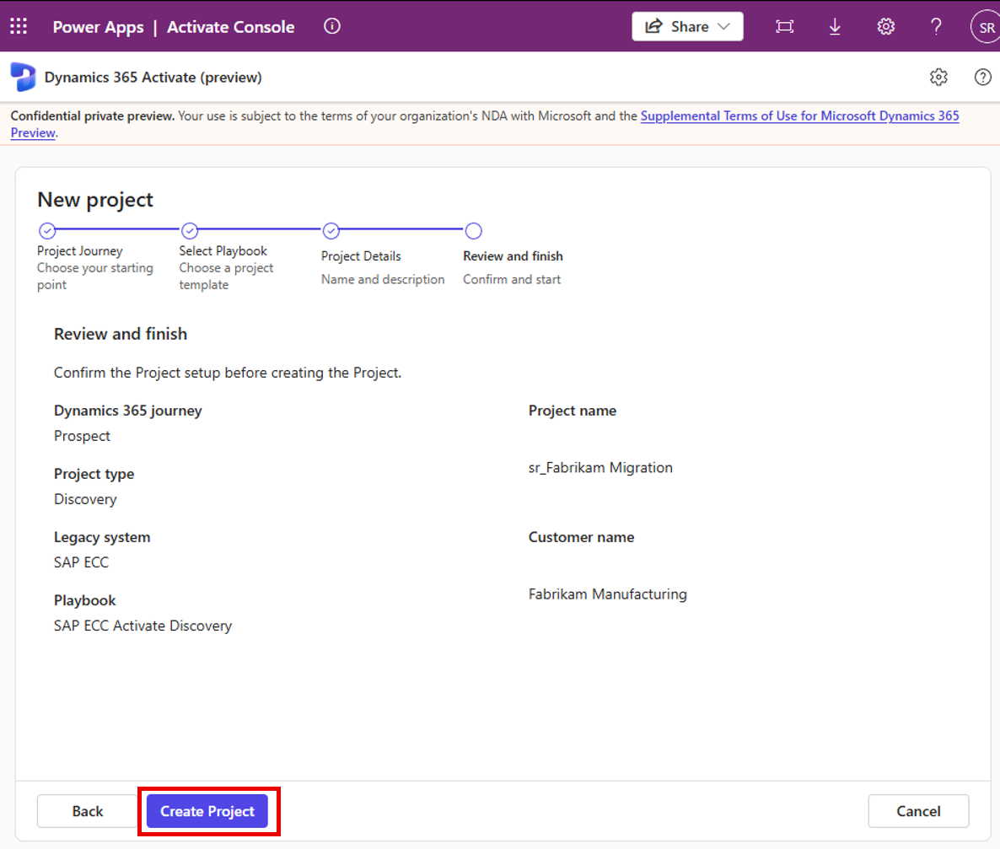
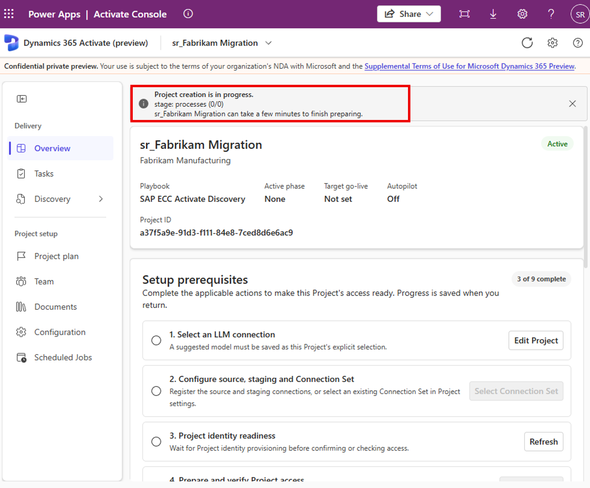
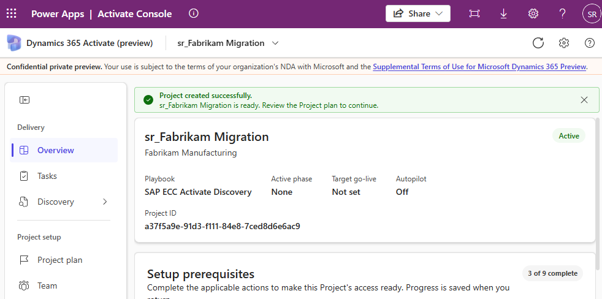
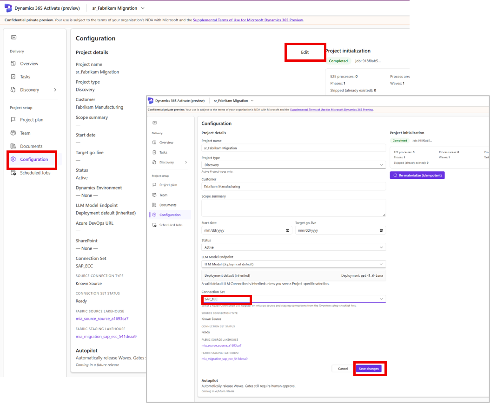

# Exercise 1: Create the project

The customer needs a discovery project. In this exercise, you create the
project in the Dynamics 365 Activate console and bind the SAP ECC Activate
Discovery playbook.

## Task 1: Start a new project

1.  In the Activate Console (Power Apps) tab, on the home page you can see the
list of projects accessible to you already. Open Dynamics 365 Activate
(preview).

*Figure 2. Launching Dynamics 365 Activate.*

1.  Select + New project.

1.  On Project Journey, under Where are you in your Dynamics 365 journey?, select
Prospect.

*Figure 3. Project Journey page: select Prospect as the journey.*

1.  Under Legacy System, select SAP ECC, and then select Next.

1.  On Select Playbook, select SAP ECC Activate Discovery, and then select Next.
This playbook is authored and published by Microsoft.

*Figure 4. Select the playbook.*

1.  On Project Details, enter Fabrikam Manufacturing as the customer's name and
\<YourInitials>_Fabrikam Migration as the project name. Select Next.

Note: Your environment is shared and you would be able to view other projects
as well. Please ensure you make a note of your project name and only make edits
to yours.

*Figure 5. Add customer and project names.*

1.  On Review and finish, confirm the values and select Create Project.

*Figure 6. Review and create project.*

*Figure 7. Review and finish page before you select Create Project.*

*Figure 8. Project creation completed.*

Checkpoint: The Overview shows the project name from Step 6 with status Active
and playbook SAP ECC Activate Discovery.

Note: Before proceeding to the next step, wait until project creation is
completed, might take a few minutes. This is essential to ensure all required
pre-requisites and sets are set up for your project accurately.

1.  Once the project is created, refresh the screen to load the next steps. There
will be a list of setup prerequisites listed. You can skip them and select
Configuration, and then select Edit on the window.

1.  On the Connection Set dropdown box, select SAP_ECC and Save changes.

*Figure 9. Configure the Connection Set.*
