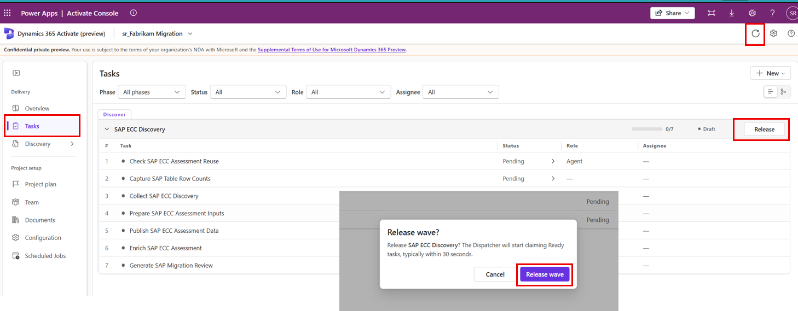
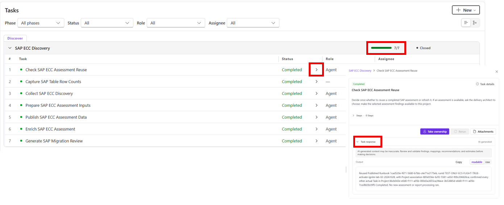
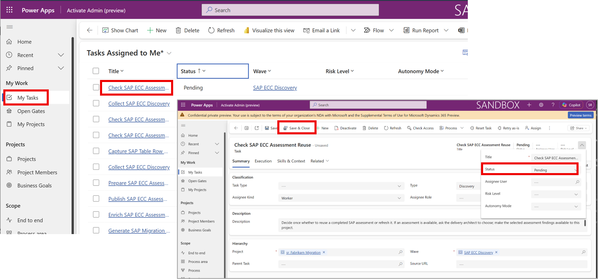

# Exercise 2: Release the discovery wave

The playbook creates one phase (Discover), one wave (SAP ECC Discovery), and
seven tasks. Release the wave to start the tasks.

## Task 1: Release the SAP ECC Discovery wave

*  In the Activate Console, select Tasks in the left navigation.
*  In the SAP ECC Discovery wave, select Release.
*  In the Release wave? dialog, select Release wave.
*  Once you release the wave, use the refresh icon in the upper-right corner to
see the progress. The tasks may take a few minutes to complete.

*Figure 10. Release wave dialog for SAP ECC Discovery.*

> **Note:** After you release the wave, the tasks start. Refresh the page to see their progress. The tasks may take a few minutes to complete.

> **Note:** While waiting for tasks to complete, you can start Exercise 3 by reviewing an already created project. Open the project dropdown next to **Fabrikam Migration** and select **Contoso Migration Assessment**.

## Task 2: Track the seven discovery tasks

On the Tasks page, refresh the page until every task shows Completed.

| #   | Task                              | Role  |
| --- | --------------------------------- | ----- |
| 1   | Check SAP ECC Assessment Reuse    | Agent |
| 2   | Capture SAP Table Row Counts      | -     |
| 3   | Collect SAP ECC Discovery         | Agent |
| 4   | Prepare SAP ECC Assessment Inputs | Agent |
| 5   | Publish SAP ECC Assessment Data   | Agent |
| 6   | Enrich SAP ECC Assessment         | Agent |
| 7   | Generate SAP Migration Review     | Agent |

*Figure 11. Tasks page with all seven SAP ECC Discovery tasks completed.*

**Checkpoint:** The SAP ECC Discovery wave shows **7/7**, and its status is **Closed**.

## Troubleshooting

If a task remains in Pending for more than 10 minutes, the task is stalled and
must be manually reset and rerun.

1.  Navigate back to make.powerapps.com (https://make.powerapps.com/).
2.  From Apps, launch the Activate Admin app.
3.  In the left navigation, select My Tasks.
4.  Select the stalled task.
5.  Reset its status.
6.  Select Save and Close.

*Figure 12. Troubleshooting a stalled task.*
