# Exercise 3: Review the discovery results

With the wave closed, the assessment results become available for review. The
Discovery overview brings together the key findings and headline metrics from
the assessment, providing a structured view of the customer's existing system
landscape. These results can then be used to explain the current estate to the
customer and steering committee and support further solution planning and
decision-making.

## Task 1: Open the Discovery overview

1.  In the left navigation, expand Discovery, and then select Overview.

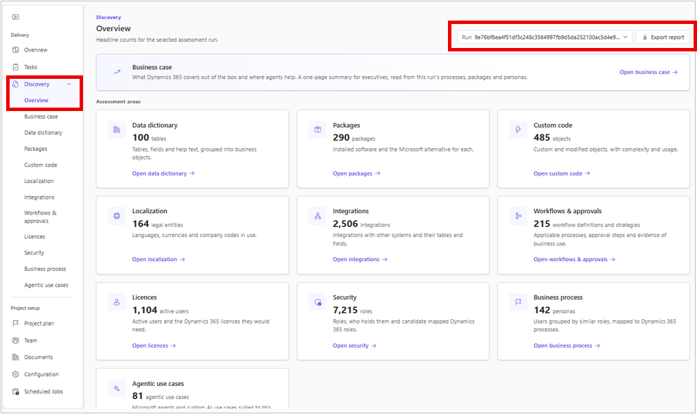

*Figure 13. Discovery overview for the project.*

## Task 2: Read the headline numbers

Compare your results with the following values from the published assessment
run.

| Area              |                                  Result | What it means                                                       |
| ----------------- | --------------------------------------: | ------------------------------------------------------------------- |
| Data dictionary   |        100 tables (85 business objects) | Tables, fields, and help text, grouped into business objects.       |
| Packages          |                            290 packages | Installed software and the Microsoft alternative for each.          |
| Custom code       |                             485 objects | Custom and modified objects, with complexity and usage.             |
| Localization      |                      164 legal entities | Languages, currencies, and company codes in use.                    |
| Integrations      |                      2,506 integrations | Integrations with other systems and their tables and fields.        |
| Workflows         | 215 workflow definitions and strategies | Applicable processes, approval steps, and evidence of business use. |
| Licenses          |                      1,104 active users | Active users and the Dynamics 365 licenses they would need.         |
| Security          |                             7,215 roles | Roles, who holds them, and their Dynamics 365 equivalents.          |
| Business process  |                            142 personas | Users grouped by similar roles, mapped to Dynamics 365 processes.   |
| Agentic use cases |                    81 agentic use cases | Microsoft agents and custom AI use cases suited to this system.     |

## Task 3: Turn Discovery findings into a migration recommendation

Your customer's steering committee knows that remaining on SAP ECC carries
support and technical-debt concerns. Before committing to a migration, it needs
to understand what must be protected, what could be simplified, where delivery
risks exist, and how a new solution could improve the business.

You are the migration consultant working with the customer and its
implementation partner. Your assignment is to turn the Discovery results into a
practical scope-and-readiness recommendation, not simply describe the size of
the existing system.

Throughout this task, consider both perspectives:

*  Customer: What business capability does this support? What could improve? Who
needs to validate the findings or prepare for change?
*  Partner: What affects solution fit, dependencies, implementation effort,
testing, and confidence in the estimate?

Keep brief working notes as you explore. For each page, capture a finding, its
business consequence, your proposed next action, and the customer or partner
role needed to validate it. These notes will become your steering-committee
briefing.

**Important:** Use your training project for these activities. Treat AI-generated recommendations, mappings, effort estimates, and potential benefits as inputs for review, not approved designs or guaranteed outcomes. If a named example is unavailable, choose a comparable record and record its actual name. You do not need to reproduce the numbers shown in the lab screenshots.

### Task 3.1: Business case - establish the value hypothesis

Business case brings together potential modernization benefits and planning
considerations. A customer sponsor or business owner uses this information to
connect the migration investment to business priorities, such as simplifying
operations, reducing legacy dependencies, or improving employee productivity. A
partner engagement lead uses it to focus discovery discussions and identify the
assumptions that need validation before making delivery commitments.

Start with a hypothesis: the migration could improve a business outcome while
reducing unnecessary legacy complexity. You will test that hypothesis as you
explore the remaining Discovery pages.

**Explore and decide**

*  Open Discovery > Business case.
*  Review Value by business area, What you leave behind, and Plan ahead for a
smooth move. Choose one potential benefit that would matter to the customer's
steering committee.
*  Follow a supporting link, such as Packages or Business process. Identify a
finding that supports the potential benefit or reveals a condition that must be
met before it can be realized.
*  Return to Business case. In your working notes, complete this statement:  

“The customer could improve  if we validate  with .”

**Checkpoint:** You have a business-value hypothesis, a supporting page reference, and a validation condition. You have not assumed that the benefit has already been achieved.

### Task 3.2: Data dictionary - protect a complete business transaction

Data dictionary helps the customer's data owners and SAP functional leads
understand the structures behind their business information. A partner
data-migration architect uses this evidence to investigate dependencies,
extraction risks, reconciliation needs, and migration sequencing.

The goal is not to move every discovered table. It is to preserve the
information needed to run the business, meet retention obligations, and
maintain complete, consistent transactions. A table that looks straightforward
in isolation may depend on other records that are easy to overlook.

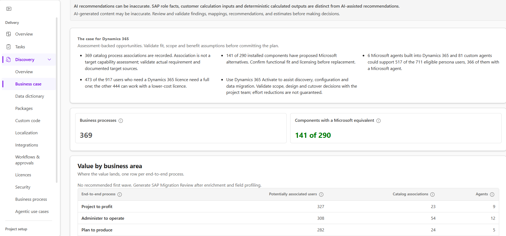

*Figure 14. Data Dictionary page with Table view.*

**Explore and decide**

*  Open Data dictionary > Tables. Use Search to find BSEG, or select another
table relevant to a business area you want to protect.
*  Select Open details for the table. Review Table dependencies, then compare the
Parents and Children views. Open a related-table button to investigate one
dependency.
*  Review Include out of scope. Consider how a dependency could be missed if
related tables were excluded from the normal view. Do not exclude a table
solely because it is empty, custom, or assigned a low priority.
*  Open Business objects. Use Kind or Search to investigate an object and its
extraction-risk information. Explain how reviewing a business object
complements reviewing an individual table.
*  Record one completeness or reconciliation question for the customer data owner
and one sequencing or extraction follow-up for the partner.

**Checkpoint:** You can explain one dependency and the business consequence of missing it. Your recommendation protects a complete business outcome rather than reproducing inventory totals.

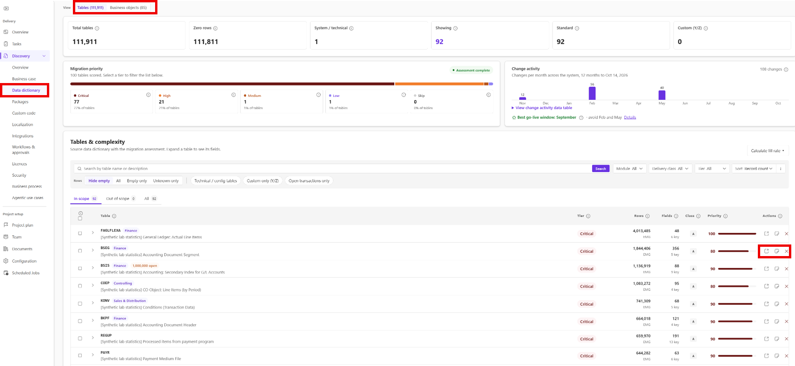

*Figure 15. Data Dictionary page with BSEG details view.*

### Task 3.3: Packages - challenge what needs to move forward

Packages shows installed components and add-ons alongside suggested Microsoft
alternatives. Customer application owners use it to identify capabilities that
remain essential, overlapping solutions, and potential opportunities to reduce
maintenance obligations. Partner solution architects use it to plan
fit-to-standard validation, vendor discussions, replacement work, and
coexistence requirements.

Installed does not necessarily mean actively used, and a suggested alternative
does not establish feature parity. A missing Microsoft match also does not
automatically mean that custom development is required.

**Explore and decide**

*  Open Packages. Search for Create Travel Request OData Integration, then select
Open details for the record.
*  Read Overview to understand the source component and its purpose. Open
Microsoft alternative and identify one business requirement that must be
validated before recommending the alternative.
*  Follow the Learn link to investigate the proposed capability. In your working
notes, distinguish the source-system facts from the suggested future-state
solution.
*  Practice a reversible scope decision in your own training project. Record an
in-scope package's original status. For this simulation only, assume its owner
has confirmed that the capability is retired and has no remaining dependencies.
Select Move out of scope, then use Out of scope to locate it.
*  Select Move into scope to restore its original status. Record the evidence
that would be required to approve a real retirement decision. If the project is
shared or you cannot restore the status, inspect the scope views without
changing a record.

**Checkpoint:** You understand how scope decisions affect the assessment and why retirement or replacement requires business validation. Any training-only scope change has been restored.

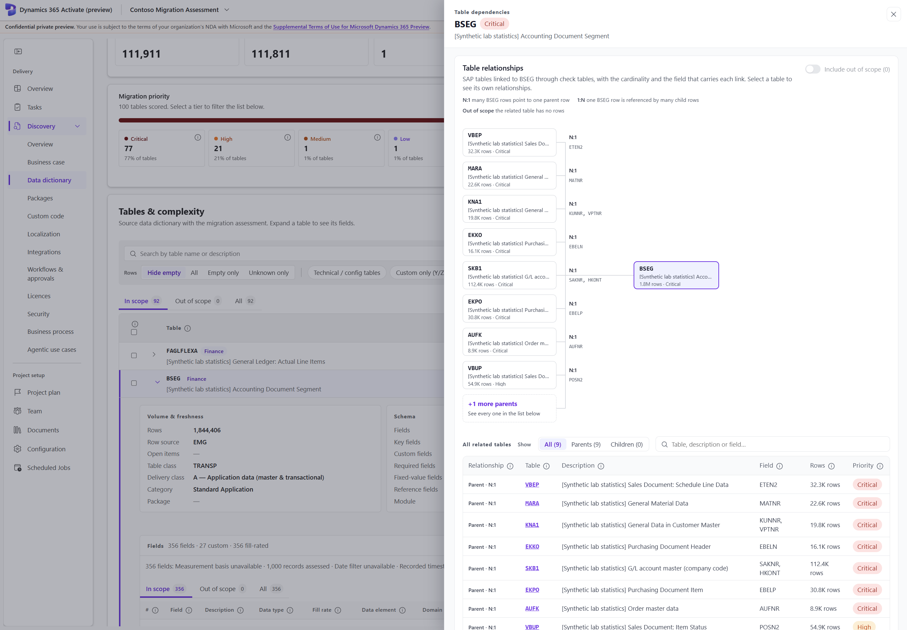

*Figure 16. Packages page with the confidence tiles and package list.*

### Task 3.4: Custom code - distinguish business value from technical debt

Custom code surfaces extensions and modified standard objects that may
complicate modernization. The customer's application owner and process experts
explain which business rules the code supports and whether those rules are
still needed. The partner's technical architect uses repository evidence,
complexity signals, and source analysis to identify investigation, remediation,
and regression-testing work.

Do not assume that every customization must be rebuilt. The better question is
whether its business purpose should be retained, replaced with standard
functionality, redesigned, or retired after validation.

**Explore and decide**

*  Open Custom code. Use Origin, Type, or Complexity to focus on a candidate that
could affect the migration approach.
*  Open details for /MSFTDI/1LAKEACCESSCHECK, or another available candidate.
Compare Overview and Repository to distinguish what is known about the object
from what remains unknown about its business use.
*  Open Source analysis and review any existing analysis. If analysis is
unavailable, record the gap rather than assuming that the code is simple or
unnecessary. You do not need to start a new analysis run for this exercise.
*  Open a record under Modified standard objects and inspect Changes. Identify a
business behavior or regression-test question that would need attention when
moving away from the modified source behavior.
*  Record a provisional treatment for one object: retain, replace, redesign,
retire, or investigate. Identify the customer owner and partner technical
reviewer needed to approve it.

**Checkpoint:** You have connected a technical finding to a business-rule or testing question. You have not treated an object count or complexity rating as a complete implementation estimate.

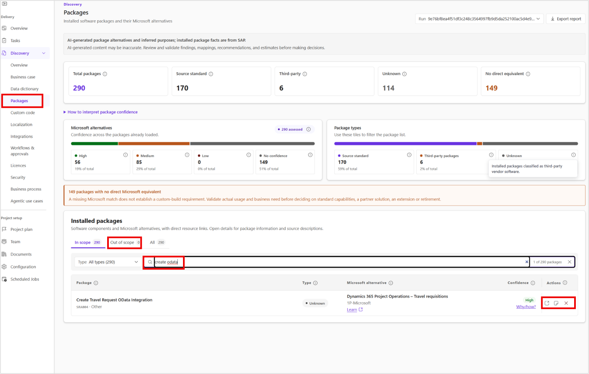

*Figure 17. Open details panel for /MSFTDI/1LAKEACCESSCHECK, showing the Overview, Repository, and Source analysis tabs.*

### Task 3.5: Localization - identify regional readiness requirements

Localization brings together legal-entity guidance, language information, and
currencies. Customer finance, tax, and regional operations owners use this
information to identify statutory and operational requirements. Partner
functional and localization specialists use it to plan configuration, country
validation, testing, and rollout dependencies.

A small regional requirement can become a major go-live issue when discovered
late. However, an installed language or configured currency does not, by
itself, prove that a particular country or requirement belongs in scope.

**Explore and decide**

*  Open Localization and review Legal entity localization guidance. Choose one
legal entity or regional guidance item to investigate.
*  Use Search to explore a relevant language or currency. Compare the information
in Language distribution and Currencies, clearing the search when needed.
*  Identify one requirement that needs specialist confirmation, such as statutory
reporting, local-language training, or currency conversion and reconciliation.
Separate the observed configuration from the requirement you still need to
confirm.
*  Record a proposed readiness gate: who on the customer team must validate the
requirement, which partner specialist should participate, and what evidence
would allow the region to proceed.

**Checkpoint:** You have identified a regional readiness question and an accountable reviewer. You have not inferred a jurisdiction solely from its currency.

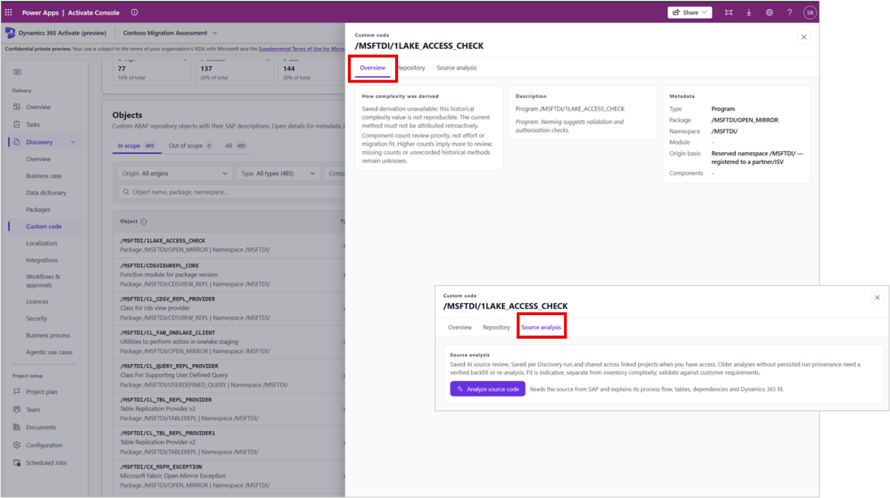

*Figure 18. Localization page with the language and currency tables.*

### Task 3.6: Integrations - uncover dependencies that could disrupt cutover

Integrations helps explain how SAP participates in the wider application
landscape. Customer integration and application owners use it to protect
exchanges that keep operations running. Partner integration architects use the
evidence to identify sequencing, authentication, testing, and cross-team work
that could otherwise be missed in the delivery plan.

Follow one interface from its business purpose through to its cutover
implications. A configured interface is not necessarily active, and a
recommendation or effort indicator is not an approved design or fixed delivery
commitment.

**Explore and decide**

*  Open Integrations. Use Technology, Direction, or Module to focus the list,
then open details for /DSD/HHCONTROL, or a comparable interface.
*  Review Overview and Flow graph. Describe what connects to what and the
business exchange that could be affected if the interface stopped working.
*  Inspect Authentication, Data movement, and Dependencies. Identify one item to
validate before cutover, such as an authentication transition, data-format
requirement, or dependent system. Do not copy credentials or secrets into your
notes.
*  Review Usage & health and Logic, then compare Assessment, Recommendation, and
Effort. Identify one assumption that could change the proposed treatment or
delivery effort.
*  Read Scope & governance. Use Add a note to to record the observed dependency,
its business consequence, the reviewer role, and the unresolved question.
Select Add note and confirm that the note appears.

**Checkpoint:** Another team member could use your note to investigate a specific cutover dependency. You have made uncertainty visible rather than assuming that every interface is equally important or equally difficult.

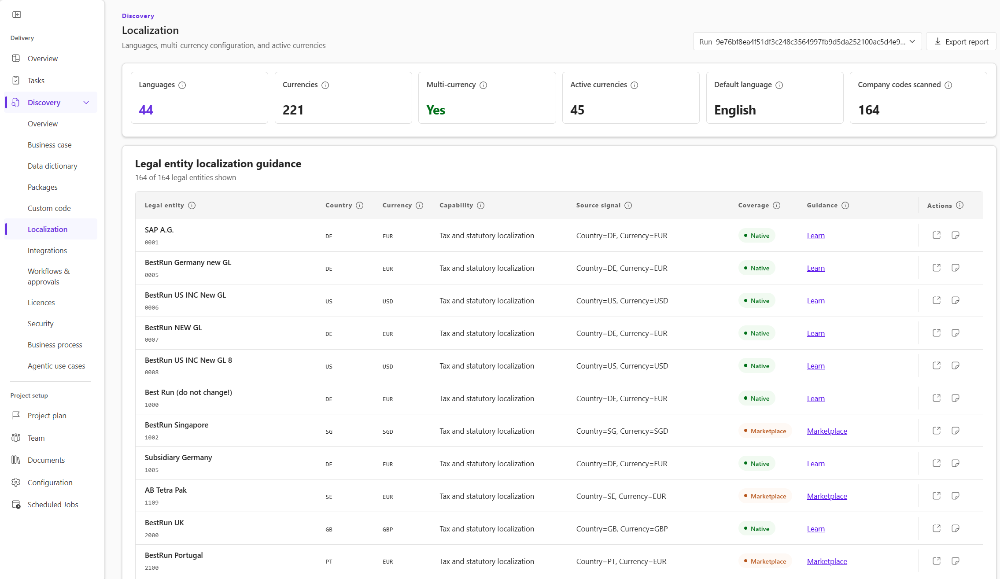

*Figure 19. Integrations page with the type and platform tiles and the details*
pop-out.

### Task 3.7: Workflows & approvals - preserve controls while improving the process

Workflows & approvals shows how work is triggered, routed, and authorized.
Customer process owners and internal-control specialists use it to distinguish
essential controls from avoidable delay. Partner functional consultants use it
to plan future-state workshops, configuration, exception handling, and
acceptance tests.

Modernization is an opportunity to challenge unnecessary steps, not simply
reproduce the legacy workflow. Any simplification must still preserve the
business accountability and controls that matter.

**Explore and decide**

*  Open Workflows & approvals. Search for Release/BoD US, or choose a comparable
workflow, and open its details.
*  Review Overview and Flow design. Identify the business event and describe the
approval path in plain language.
*  Inspect Conditions & triggers and Roles & approvals. Choose one decision point
or approver responsibility that the customer process owner must validate.
*  Review Usage & health and Evidence & gaps. Identify an exception or missing
fact that should be resolved before redesigning the workflow.
*  Draft an acceptance criterion in your working notes:  

“When  occurs under  conditions,  must approve or receive the item.”
*  Add one change-management action, such as preparing an approver for a revised
responsibility.

**Checkpoint:** You have a testable control requirement and a people-readiness action. You have not assumed that fewer approvals are always better.

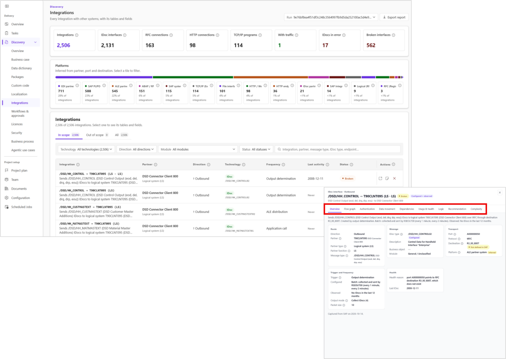

*Figure 20. Workflows page with the inventory tiles and workflow list.*

### Task 3.8: Licenses - challenge the assumptions behind the cost picture

Licenses brings together user-license guidance, platform and capacity
considerations, and usage insights. Customer application owners, procurement,
and finance use it to question who needs which capabilities. Partner licensing
specialists use it to prepare a more defensible licensing and capacity
discussion based on future responsibilities and solution needs.

Usage signals can reveal opportunities for review, but inactivity alone does
not establish that an account or license is unnecessary. Seasonal users,
service identities, or changing responsibilities may require a different
interpretation.

**Explore and decide**

*  Open Licenses. Compare User licenses, Platform and capacity, and Additional
platform consumption to plan for.
*  Identify one planning consideration that would be missed by looking only at
named-user licenses.
*  Under Usage insights, open details for Users to review: no logon in 180 days,
or a comparable insight. Review Overview and Evidence & calculation to
understand the observation and how the recommendation was derived.
*  Record one explanation that could invalidate an apparent saving, such as a
seasonal user who is still required. Identify the customer owner who can
confirm the account's purpose and expected future duties.
*  Capture a licensing assumption for specialist review. Do not remove users,
change license assignments, or present the guidance as a final quote.

**Checkpoint:** You can distinguish a usage-based review opportunity from an approved license reduction, and your cost discussion includes capacity as well as users.

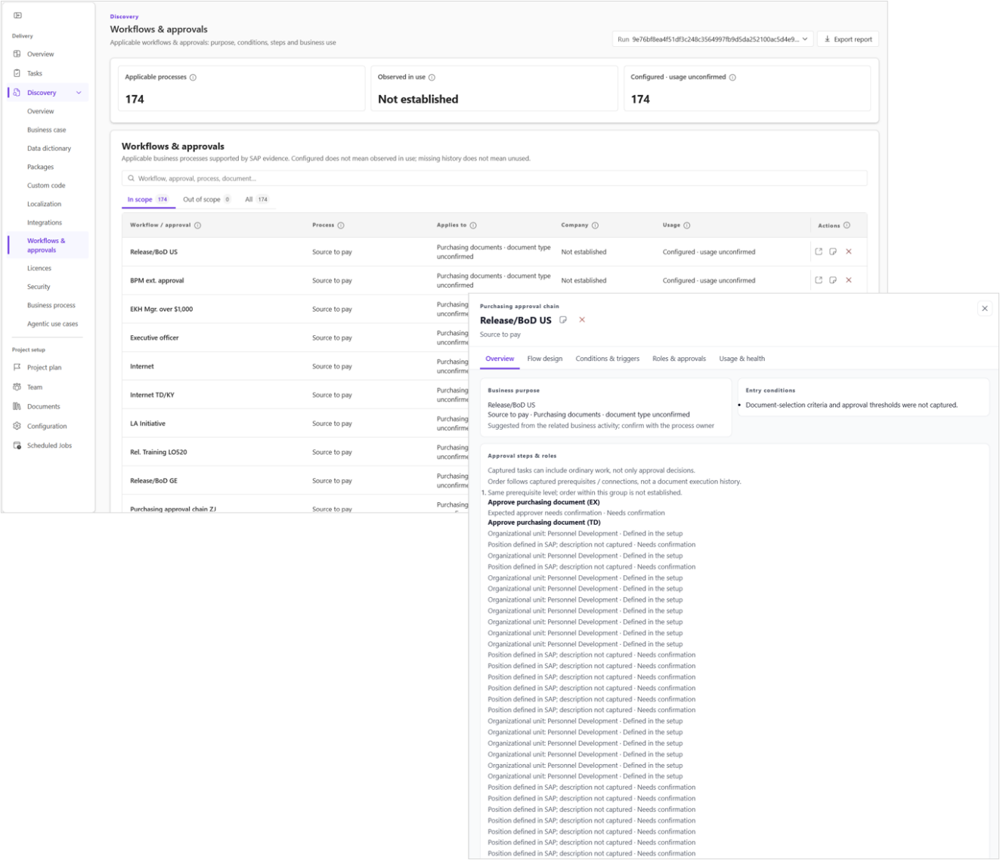

*Figure 21. Licenses page with user counts and future license estimates.*

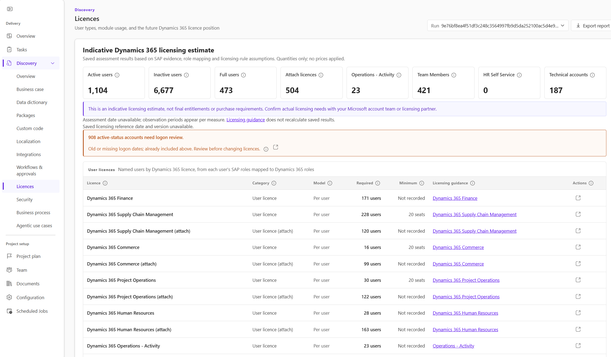

*Figure 22. Details on the Dynamics 365 Finance licenses.*

### Task 3.9: Security - validate access rather than matching role names

Security helps customer security owners and business approvers understand who
can do what and across which organizational boundaries. Partner security
architects use the source evidence and candidate mappings to plan target-role
design and access tests.

A role-name or catalog match does not establish equivalent permissions or
acceptable segregation of duties. The objective is to preserve appropriate
access while identifying opportunities to improve controls, not mechanically
copy the legacy role catalog.

**Explore and decide**

*  Open Security. Review Migration summary and Catalog match, then use the Module
filter or Search roles to investigate a relevant role.
*  Expand a row in Roles assigned to users to inspect its available matches.
Compare that evidence with Module access and Role hierarchy.
*  Review Organizational levels and Company-code access for a boundary relevant
to the selected role. Record whether the page establishes that boundary or
leaves it unresolved.
*  Draft one positive and one negative access test: what the intended user should
be allowed to do, and what they should not be allowed to do outside their
responsibility.
*  Identify the customer business approver and partner security reviewer who
should validate the tests. Mark unverified permissions as questions rather than
confirmed findings.

**Checkpoint:** You have translated a security finding into an access-validation question tied to business responsibility and an organizational boundary.

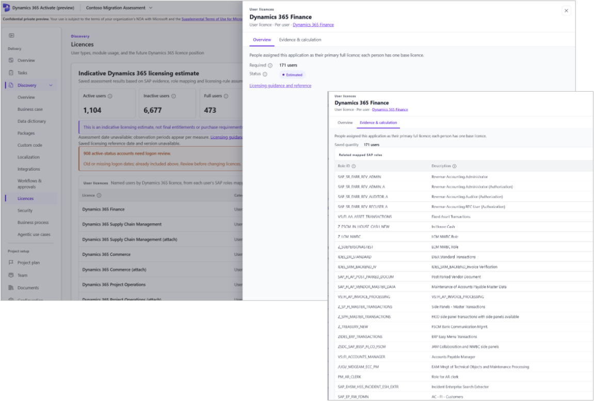

*Figure 23. Security page with details on roles hierarchy and organization*
levels.

### Task 3.10: Business process - connect technical findings to people and work

Business process connects observed personas and activities with candidate
Dynamics 365 mappings. Customer process owners, subject-matter experts, and
change leads use it to discuss how work may change and who needs to
participate. Partner functional leads use it to focus fit-to-standard workshops
and testing on business activities.

A discovered activity is evidence of current behavior, not proof that the
process is complete, efficient, or desirable. Your task is to turn that
evidence into a useful workshop question and a specific readiness action.

**Explore and decide**

*  Open Business process. Use Search personas and Toggle details to investigate a
persona.
*  Compare the view with Active in last 180 days enabled and disabled. Consider
why an activity filter might hide a seasonal or infrequent role that still
matters to the business.
*  Open details for ABAP Developer: Display Authorization, or another available
activity. Compare Overview with Day in the life & Dynamics 365 mapping,
distinguishing observed source activity from the proposed future-state mapping.
*  Review Business processes and use Show all products to broaden the view.
Choose a candidate mapping that requires a functional workshop rather than
treating it as accepted scope.
*  Connect the finding to a question from Custom code, Workflows & approvals, or
Security. Record one workshop question and one change-management action for the
affected persona. If the relationship is not established by the evidence,
describe it as a question for the subject-matter expert.

**Checkpoint:** You have translated a technical or control concern into a business conversation and an actionable people-readiness requirement.

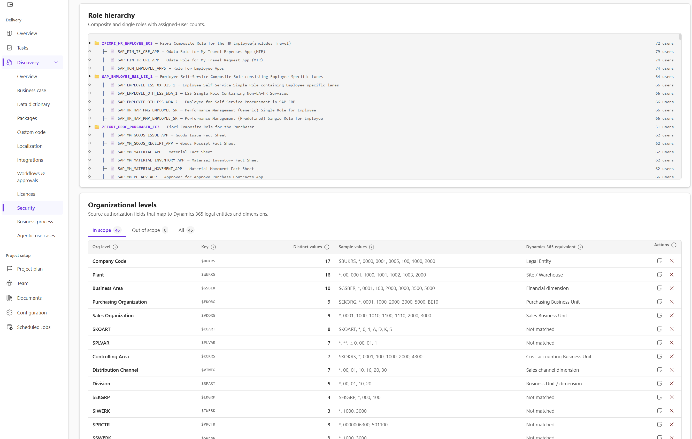

*Figure 24. Business process page with the persona table and process coverage.*

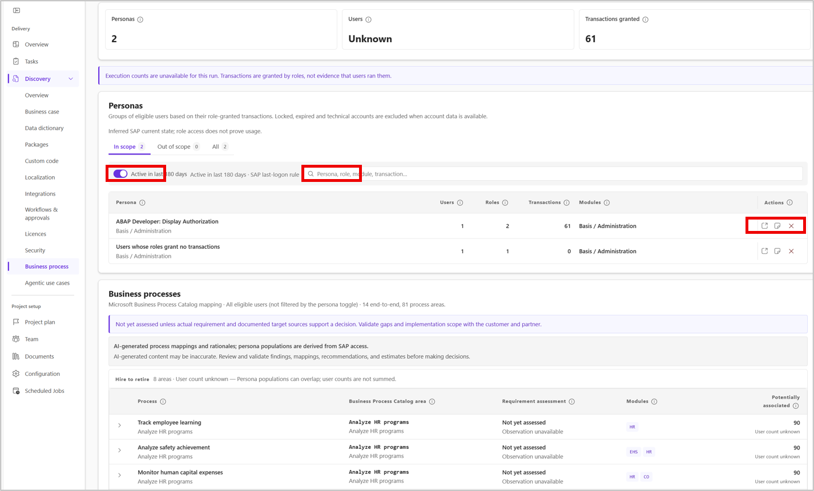

*Figure 25. Open details panel for the persona ABAP Developer: Display Authorization, showing the Overview and Day in the life & Dynamics 365 mapping tabs.*

### Task 3.11: Agentic use cases - build a credible value experiment

Agentic use cases helps customer process owners consider where assistance or
automation could reduce repetitive effort. Partner solution architects and
delivery leads use the evidence and safeguards to frame a bounded pilot, its
dependencies, and its success measures.

A modeled time benefit is a hypothesis, not automatically cash savings, reduced
headcount, or implementation return on investment. The opportunity is to
improve worthwhile work while preserving the human judgment and controls it
requires.

**Explore and decide**

*  Open Agentic use cases and read the AI disclaimer. Review the population scope
and distinguish Microsoft agents to consider from Recommended custom agentic
use cases.
*  Use View documentation for a relevant Microsoft agent to investigate its
documented purpose. Do not assume it solves the selected scenario simply
because it appears as a recommendation.
*  Open details for Approvals Agent, or another relevant custom use case. Read
Overview and Reasoning & evidence to identify the work it proposes to improve
and any missing baseline information.
*  Review Delivery & safeguards. Choose one human-review, access, or
exception-handling safeguard that must be validated before a pilot proceeds.
*  Open Savings estimate and record the original Hours spent per user per week
and Recoverable percentage. In your own training project, reduce one input,
select Save scenario estimate, and observe the effect on the displayed benefit.
Restore the original input and save again. If the project is shared or you
cannot restore the original value, compare the assumptions in your working
notes without saving changes.
*  Write a pilot hypothesis with a customer process owner, a baseline to measure,
a safeguard, and a success measure, such as verified time recovered while
maintaining required approvals.

**Checkpoint:** You have examined how assumptions influence the benefit estimate and proposed a measurable, controlled pilot. Any training-only estimate changes have been restored.

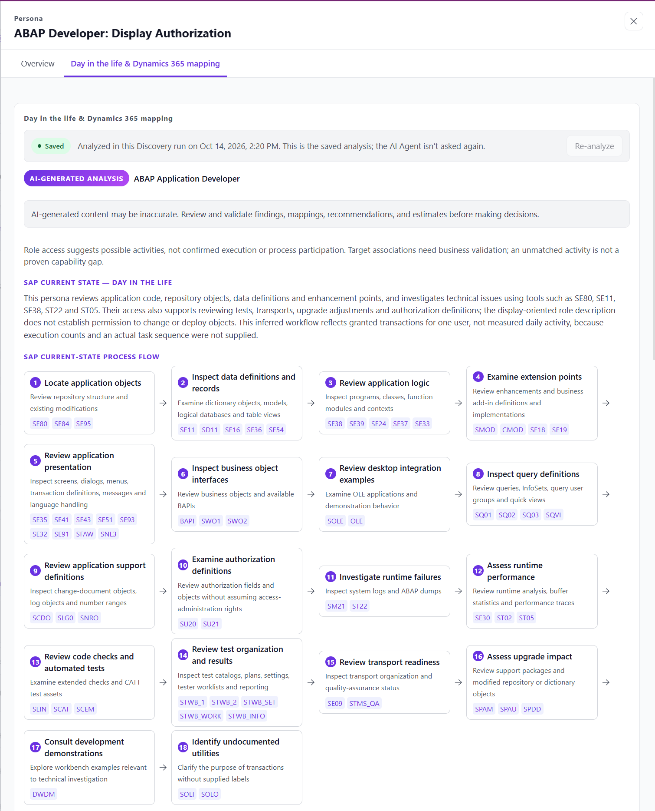

*Figure 26. Agentic use cases page with the possible Microsoft agents to*
consider.

## Task 3 checkpoint: Brief the steering committee

Return to Business case and revisit your original value hypothesis. Your
recommendation should now be better supported, more qualified, or different
because of what you discovered. Export the report and use the details and notes
you tracked throughout to create a steering committee brief.

1.  Navigate to Discovery > Business case.
2.  Select Export report.
3.  Select 25.
4.  Select the option for a PDF.
5.  Select Include notes.
6.  Select Export.

Once the file is generated, you will have a detailed file that is often very
long. You can use Copilot, Scout, or Cowork with your working notes and the
report to prepare a short verbal or written briefing covering these four points:

*  Value: Identify one business improvement worth pursuing, its supporting
evidence, and a condition for realizing it. Explain why simplifying work or
reducing risk matters even when it cannot yet be assigned a reliable financial
value.
*  Scope: Recommend one provisional retain, replace, redesign, retire, or
investigate decision. Identify the record or page supporting it, the customer
validator, and any dependency that prevents final approval.
*  Readiness and risk: Describe one business-continuity or control risk, one
people/process readiness action, and the partner follow-up needed before
committing to a design or estimate.
*  Next decision: Recommend the next validation workshop or bounded pilot.
Identify who should participate and what evidence would allow the team to
proceed or change direction.

**Final checkpoint:** Every Discovery page has contributed an evidence-based finding or an explicit evidence gap. You can connect the customer's business priorities to scope, dependencies, controls, change readiness, and potential value. Your recommendation does not promise that nothing has been missed; it makes assumptions and unanswered questions visible so the customer and partner can move forward with greater confidence.

That's a wrap on LAB701. Thanks for exploring Activate with us.
